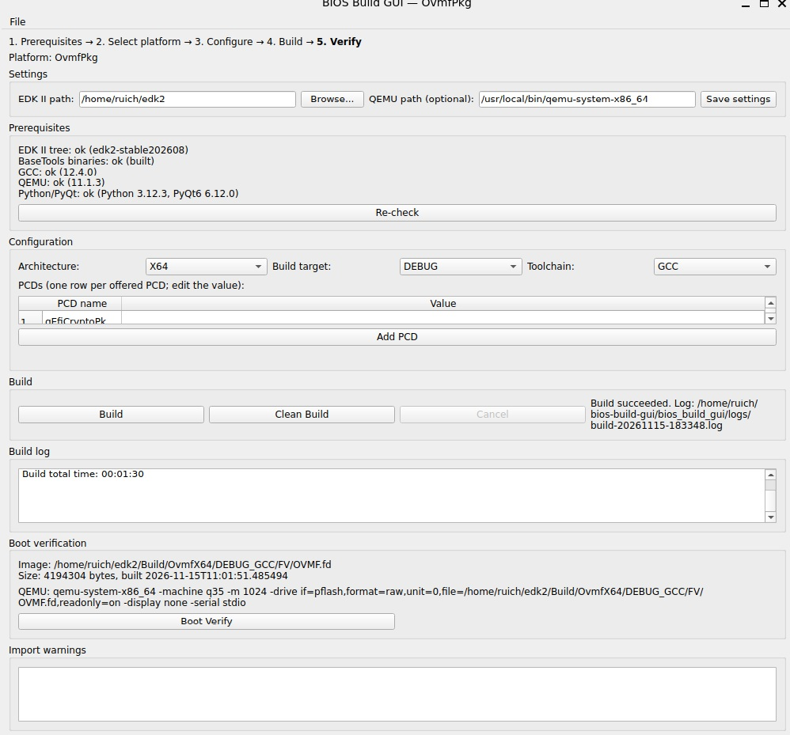
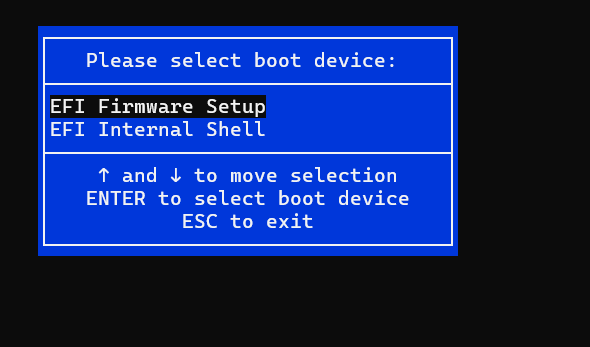
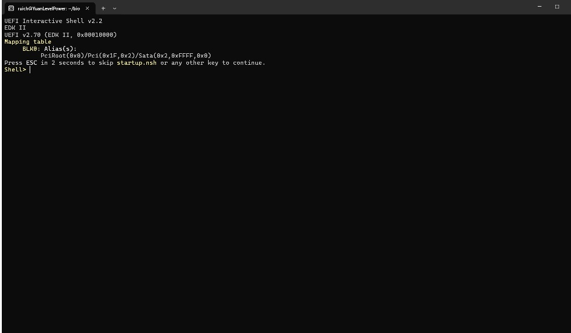

# BIOS ROM Build Project — A Working Record

A desktop tool that builds a bootable UEFI firmware image (`OVMF.fd`)
from the EDK II OvmfPkg platform package and verifies it boots to the
UEFI shell in QEMU. Written in Python with a PyQt6 GUI. The repository
is public: <https://github.com/Yao-heng/bios-build-gui>.

This document is a working record of the project: what has to be
installed before the code can build, what the test scope and spec are,
and what actually went wrong on the way to a green build — the
trial-and-error trail. The trail is the point: each failure was
diagnosed to its root cause, fixed, and verified, and the record below
is the evidence that the time spent was meaningful.

## How it works

```
Prerequisites ──► Configure ──► Generate ──► Build ──► Verify ──► Shell
(EDK II, GCC,     (arch, build     (wrapper DSC    (EDK II        (QEMU boots
 QEMU, Python,     target, PCDs)     + FDF)          `build`)        OVMF.fd)
 PyQt6, nasm,
 iasl, BaseTools)
      │                │                │               │              │
      ▼                ▼                ▼               ▼              ▼
  GUI checks       Config Model    OvmfPkg adapter   Build Runner   Boot Verifier
  each item        validates       writes files      streams log    drives the
  (I5)             (I1)            (I2)              (I3)           Boot Manager
                                                                    menu (I4 v2)
```

The pipeline in words: the GUI checks that every prerequisite is
present (I5), the user configures the platform (I1), the OvmfPkg
adapter generates a wrapper DSC and FDF into the EDK II workspace
(I2), the Build Runner invokes the EDK II `build` command and streams
its output to the log view (I3), and the Boot Verifier boots the
produced `OVMF.fd` in QEMU and drives the Boot Manager menu to the
UEFI shell (I4 v2). The build and the boot are separate verdicts: a
successful build with a failed boot verify is reported as "build
succeeded, boot verify failed", not as a build failure.

The approved design is in [design.md](design.md) (EGM: Brainstorm →
Draft → Review → Resolve → Implement).

## Prerequisite tools — the complete install list

Everything below must be installed before the code can build. The
versions are the pinned versions validated on the implementation
machine (WSL Ubuntu, user `ruich`); the GUI's Prerequisite Checker
(I5) verifies the EDK II tree, the BaseTools binaries, GCC, QEMU, and
Python/PyQt at startup and disables Build until every check passes.

| Tool | Pinned version | How to install / obtain |
| --- | --- | --- |
| EDK II | edk2-stable202608 | `git clone` the EDK II tree and check out the tag; initialise the submodules (`git submodule update --init`). The tree must contain `edksetup.sh` and `OvmfPkg/OvmfPkgX64.dsc`. |
| GCC | 12 (major; 12.4.0 on the implementation machine) | Ubuntu `gcc` package. The EDK II toolchain tag is `GCC` (a toolchain-family name, not a compiler version). |
| Python | 3.10+ (3.12.3 on the implementation machine) | System Python. The tool requires `>=3.10` (`pyproject.toml`). |
| PyQt6 | 6.12.0 | `pip install -e .` (declared in `requirements.txt` as `PyQt6==6.12.0`). |
| QEMU | 11.1.3 | Source-built `qemu-system-x86_64` on PATH. KVM acceleration is used when `/dev/kvm` is present and accessible; otherwise the verifier falls back to TCG (software emulation). |
| nasm | (system package) | `sudo apt install -y nasm`. **Not checked by the GUI prerequisite checker** — discovered only when the build failed (see § "nasm: not found"). |
| iasl (acpica-tools) | (system package) | `sudo apt install -y acpica-tools`. **Not checked by the GUI prerequisite checker** — discovered only when the build failed (see § "iasl: not found"). |
| BaseTools binaries | (built from the EDK II tree) | `make -C BaseTools` in the EDK II tree. The runner builds them once in its pre-build phase if they are missing; the GUI prerequisite checker also verifies them. A *partial* BaseTools build was not caught — see § "GenFfs ERROR 1000: SectionAlign — the misleading error". |
| git, make | (system packages) | Needed to clone EDK II and build BaseTools. |
| Development tools | pytest 9.2.0, pytest-cov 7.1.0, ruff 0.17.4 | `pip install -r requirements-dev.txt`. Only needed to run the tests and the linter. |

Two gaps in the prerequisite check are known and recorded as
follow-up work: the GUI checks for EDK II, BaseTools, GCC, QEMU, and
Python/PyQt, but it does **not** check for nasm or iasl. Both were
found the hard way — by a build failure — and both are documented
below so the next person does not repeat them.

### Install and launch

```bash
git clone https://github.com/Yao-heng/bios-build-gui.git
cd bios-build-gui
python -m venv .venv
.venv/bin/pip install -e .
.venv/bin/pip install -r requirements-dev.txt   # development only
```

Launch:

```bash
.venv/bin/bios-build-gui
```

On first launch the Settings panel asks for the EDK II tree path (the
directory containing `edksetup.sh`). The build is disabled until every
prerequisite check passes.

## Test scope and spec

The test scope is defined by four Customer Usage Journeys (CUJs) and
by the interface contracts (I1–I5) in the design doc. The contract
tests run anywhere (fixtures + a fake QEMU stand in for the
toolchain); a real EDK II build and QEMU boot are verified only in the
E2E run on a machine with the pinned toolchain installed.

| CUJ | What it covers | Status |
| --- | --- | --- |
| CUJ 1 | Build OvmfPkg → boot to the UEFI shell | **Complete** (2026-11-15): build green, boot to `Shell>` verified manually; the Boot Verifier now drives the menu automatically (I4 v2). |
| CUJ 2 | Wrong EDK II path | Not yet run: the prerequisite check names the wrong path and gives a fix hint. |
| CUJ 3 | Invalid config field | Not yet run: a build with an invalid config, run through the GUI, shows a field error in the editor and no build is attempted. |
| CUJ 4 | Import DSC/FDF → edit → rebuild → boot | Not yet run: import an existing OvmfPkg DSC/FDF, edit a setting, rebuild, and confirm the image still boots. |

The spec is the interface registry in [design.md](design.md):

- **I1 — Config Model** (schema v1): platform, architecture (X64
  only in v1), build target, toolchain, PCDs; validation returns
  field errors.
- **I2 — Platform Adapter**: `generate(config)` writes a wrapper DSC
  (with its own complete `[Defines]` — see § "error 5000") and a
  generated FDF, and returns the build command and the expected image
  path; `import(dsc_path, fdf_path)` parses DSC/FDF back into a
  config.
- **I3 — Build Runner**: invokes the build command as a subprocess,
  streams output line-by-line to the GUI log view, writes the full log
  to `<project>/logs/build-<timestamp>.log`, and returns the exit
  code. Success is exit code 0 only.
- **I4 — Boot Verifier (v2)**: launches QEMU with the image as a
  pflash drive, drives the Boot Manager menu to the UEFI shell, and
  returns one of three verdicts — `booted`, `boot_to_shell_fail`,
  `not_booted` — plus the captured output and an interaction trace.
  Default timeout 30 s (measured: ≈ 2 s to the BdsDxe prompt,
  ≈ 5 s to the shell under TCG).
- **I5 — Prerequisite Checker**: checks the EDK II tree, the
  BaseTools binaries, GCC, QEMU, and Python/PyQt; each result carries
  a status (`ok` | `missing` | `mismatched`), the found and expected
  versions, and a fix hint.

Current test state (2026-11-15): **87 tests pass** (83 contract/unit
tests + 3 new menu-drive contract tests + 1 GUI verdict-mapping
test), `ruff check` clean, `ruff format` clean. The G2 acceptance
(a recorded demo video + README screenshots of a full CUJ 1 run) is
still to be produced.

## The trial-and-error record

Every failure below was diagnosed to its root cause and fixed. The
two disproved theories are recorded below, so nobody retries them.

```
2026-11-11  Build 1:  Tool chain [GCC5] is not defined
              └─► fix: toolchain tag GCC5 → GCC (commit d8d2fca)
2026-11-11  Build 2:  error 5000: No SUPPORTED_ARCHITECTURES
              └─► fix attempt 7300e6f (wrong theory — disproved)
2026-11-14  Build 3:  error 5000 again (same error)
              └─► root cause found 2026-11-15 (see below)
2026-11-15  Fix: emit a complete [Defines] in the generated DSC
              └─► commit 6246094; error 5000 gone
2026-11-15  /bin/sh: 1: nasm: not found (error 7000 / F002)
              └─► sudo apt install -y nasm
2026-11-15  GenFfs: ERROR 1000: SectionAlign option must be
            specified with section file (ResetVector)
              └─► symptom; root cause: GenSec binary missing
              └─► make -C BaseTools (GenSec rebuilt; error gone)
2026-11-15  /bin/sh: 1: iasl: not found (error 7000 / F002)
              └─► sudo apt install -y acpica-tools
2026-11-15  BUILD SUCCEEDED — OVMF.fd produced (4,194,304 bytes)
2026-11-15  Boot Verify: "Not booted" (verifier only accepted Shell>)
              └─► design assumption wrong; firmware stops at the
                  Boot Manager prompt (verified manually → CUJ 1)
2026-11-15  Boot Verifier fix (I4 v2): menu drive, three-state
            verdict, 30 s timeout, chunk reader, trace
              └─► commit 23470e2; 87 tests pass
```

### error 5000: No SUPPORTED_ARCHITECTURES

The generated wrapper DSC was just `!include OvmfPkg/OvmfPkgX64.dsc`
plus an empty `[PcdsFixedAtBuild]`. The build failed with error 5000.

**Root cause (verified in the EDK II source):** the EDK II parser
takes `SUPPORTED_ARCHITECTURES` (and the other header values) only
from the top-level DSC's own `[Defines]` section. A `[Defines]`
arriving via `!include` does not supply them. The wrapper had no
`[Defines]` of its own, so the parser found no supported
architectures.

**Two earlier theories, disproved — do not retry:**
1. The 7300e6f fix ("a second `[Defines]` drops the stock defines")
   did not fix it; Build 3 failed with the same error.
2. The "nested `!include`" hypothesis was also disproved.

**Fix (commit 6246094):** `generate()` in
`bios_build_gui/adapters/ovmf.py` now emits the full `[Defines]`
section before the `!include` (PLATFORM_NAME/GUID/VERSION,
DSC_SPECIFICATION, OUTPUT_DIRECTORY, `SUPPORTED_ARCHITECTURES` from
`config.architecture`, BUILD_TARGETS = NOOPT|DEBUG|RELEASE,
SKUID_IDENTIFIER, FLASH_DEFINITION pointing at the generated FDF).
83 tests passed, ruff clean.

### nasm: not found (error 7000 / F002)

After error 5000 was gone, the build parsed cleanly and compiled for
9 seconds, then failed on `nasm: not found` (BaseIoLibIntrinsicSev).
nasm was not installed on the machine. It has nothing to do with the
error 5000 fix.

**Fix:** `sudo apt install -y nasm`, then re-run the build.

### GenFfs ERROR 1000: SectionAlign — the misleading error

After nasm was installed, the build compiled through all modules and
failed at FV packaging: `GenFfs: ERROR 1000: Unknown option —
SectionAlign option must be specified with section file`
(ResetVector FFS).

**What the message actually means (verified in the GenFfs source):**
the message is a symptom. The section file `SEC1.1.raw` did not exist
when GenFfs ran; GenFfs skips a missing `-oi` file without consuming
the following `-n`, which then errors as an unknown option. The
directory held only two `.txt` command-record files; `.raw` and
`.ffs` were both absent, while `ResetVector.bin` did exist.

**A wrong prediction, corrected on the record:** the first hypothesis
was a one-off parallel-build race ("just re-run, it will pass"). The
re-run at 10:42:47 failed identically. That prediction was wrong and
was corrected in the project records the same day — a stated gap is
insurance; a guessed fact is a future error.

**Root cause (confirmed 10:55):** `ls BaseTools/Source/C/bin/` showed
only 4 tools (BrotliCompress, EfiRom, GenFfs, VfrCompile) — the
**GenSec binary was missing**. The PosixLike GenericShellWrapper
silently exits 0 when `EDK_TOOLS_PATH` is set and the bin directory
exists but the binary is absent, so `make` never stopped. GenSec had
never run, so no `.raw` was ever produced; the build logs showed
GenSec only as command echoes, with no output and no error, and a
manual GenSec run was also silently ineffective.

**Fix:** `make -C BaseTools` rebuilt the BaseTools binaries. The
re-run (total 1 minute 19 seconds) progressed past ResetVector —
GenSec/GenFfs succeeded for DxeIpl, Mtftp4Dxe, SataController, and
VirtioFsDxe.

### iasl: not found (error 7000 / F002)

The same build then failed at RamDiskDxe: `/bin/sh: 1: iasl: not
found`. iasl is the ACPI compiler, part of the `acpica-tools`
package. Same class of problem as nasm — a missing host tool, not a
code defect.

**Fix:** `sudo apt update && sudo apt install -y acpica-tools`, then
re-run. (Several `Error 1 (ignored)` lines in the log are `cp *.pdb`
steps — GCC produces no `.pdb` on Linux — and are benign.)

### Build succeeded

After acpica-tools was installed, the build succeeded. The GUI
advanced to the Boot Verify stage, and `OVMF.fd` was produced
(`/home/ruich/edk2/Build/OvmfX64/DEBUG_GCC/FV/OVMF.fd`, 4,194,304
bytes, built 2026-11-15T11:01:51). The full OVMF build was green
end-to-end on the implementation machine.

### Boot Verify: "Not booted" — a detection gap, not a firmware failure

The Boot Verify verdict was "Not booted: shell prompt not observed
within 60 s" — but the captured output proved the firmware boots: it
reached **BdsDxe — "No bootable option or device was found. BdsDxe:
Press any key to enter the Boot Manager Menu."** The design's
assumption ("no disk attached, so the firmware falls through to the
UEFI shell") was false for this build: with no disk attached, the
firmware stops at the Boot Manager prompt and waits for a keypress.
The verifier only accepted `Shell>`, so it timed out on an image
that boots. This was a verifier/detection gap, not a firmware
failure. Per the design, the build verdict stands ("build succeeded,
boot verify failed").

**CUJ 1 complete (2026-11-15 11:11):** QEMU was run manually with the same command, a key was pressed at the Boot Manager prompt, UEFI Shell was selected from the menu, and `Shell>` appeared.
Build succeeded + boots to the UEFI shell (manually verified).

### Boot Verifier fix (I4 v2)

The verifier was fixed to drive the Boot Manager menu itself,
through the EGM design process (Brainstorm → Draft → Review → Resolve
→ Implement; the design is in
`~/workspace/designs/boot-verify-menu-drive/boot-verify-menu-drive.md`).
The measured timings on the implementation machine (manual QEMU, TCG,
DEBUG build): QEMU start → BdsDxe prompt ≈ 2 s; QEMU start → `Shell>`
via the menu ≈ 5 s total. The menu has two entries — "EFI Firmware
Setup" (initially selected) and "EFI Internal Shell" — so reaching
the shell is one Down keypress plus Enter.

What changed (commit 23470e2):

- `verify_boot` returns `(verdict, output)`; the verdict is one of
  `booted`, `boot_to_shell_fail` (firmware reached the Boot Manager
  but the shell was not observed), or `not_booted` (firmware never
  reached the Boot Manager), as module-level constants.
- Menu drive: space enters the menu, the `EFI Internal Shell` entry
  is confirmed present (a safety gate), then Down (`ESC [ B`) followed
  by Enter (`\r`) selects it — consecutively, with no settle delay
  (the EDK II console input queue preserves order). ESC is never sent.
- Chunk reader (`os.read`) replaces the line reader: the real `Shell>`
  prompt has no trailing newline, so a line reader cannot deliver it
  promptly. Popen runs in binary mode (`bufsize=0`, `stdin=PIPE`);
  keypresses are written as bytes by the polling thread.
- A phase guard (`watching` → `menu_entered` → `menu_driven`) makes
  each drive step fire exactly once; the check order is `Shell>` first,
  then the BdsDxe prompt, then the menu title.
- An interaction trace is appended to the returned output after a
  marker line and shown on all three verdicts; a cancelled run shows
  "Cancelled".
- Default timeout 60 s → 30 s (a judgment call: a 6× margin over the
  measured ≈ 5 s total, with the latency goal of reporting a real
  failure within ≈ 30 s).
- The base design doc was updated to I4 v2 in the same commit, so doc
  and code never disagree.

The contract tests were written first and run against the old code
(9 failed / 3 passed — proving the tests catch the missing
behaviour) before the source was changed. Final state: **87 tests
pass, ruff check and format clean**. The design itself is still "In
Review" — it is not marked Approved until it is reviewed, and the
live QEMU verification on the implementation machine (which also
confirms the ANSI-contiguity assumption) is the gate before approval.

## What the time bought

The trial-and-error trail above is the evidence. What that time bought, concretely:

- **A working tool.** The GUI builds OvmfPkg from configuration to a
  bootable `OVMF.fd` and verifies it boots to the UEFI shell — the
  full CUJ 1 loop, green end-to-end on the implementation machine.
- **A verified fix for a real EDK II behaviour.** The error 5000 root
  cause (the parser reads header values only from the top-level DSC's
  own `[Defines]`) is a fact about EDK II, verified in its source,
  not a workaround — and two wrong theories were disproved and
  recorded so they are not retried.
- **A fixed verifier, not a weakened verdict.** The Boot Manager
  problem could have been "fixed" by treating the prompt as boot
  evidence; instead the verifier now drives the menu and proves the
  shell works, with a three-state verdict that distinguishes "reached
  the Boot Manager but no shell" from "never booted".
- **87 passing tests and a clean lint.** Every behaviour above is
  covered by a contract test, including the menu drive, the
  no-shell and prompt-only failure modes, and the GUI verdict mapping.
  The tests were written first and shown to fail on the old code.
- **A design record.** The approved design
  ([design.md](design.md)) and the Boot Verifier fix design
  (`boot-verify-menu-drive.md`, in review) record the decisions, the
  alternatives considered and rejected, and the measurements the
  timeout is based on — so the next change starts from evidence, not
  from memory.

## Screenshots

**Build tool GUI** — the GUI after a successful build: all
prerequisites ok (EDK II edk2-stable202608, GCC 12.4.0, QEMU 11.1.3,
Python 3.12.3, PyQt6 6.12.0), "Build succeeded", OVMF.fd 4,194,304
bytes, built 2026-11-15T11:01:51.485494, build total time 00:01:30.



**Boot Manager menu** — the menu the firmware draws when no disk is
attached ("Please select boot device:"): "EFI Firmware Setup"
initially selected, "EFI Internal Shell" second. The Boot Verifier
(I4 v2) drives this menu with one Down keypress plus Enter.



**Boot to shell** — QEMU booted to the UEFI Interactive Shell v2.2
(EDK II, UEFI v2.70), showing the `Shell>` prompt.



## Status and what's next

- **Done:** CUJ 1 (build + boot to shell); the error 5000 fix
  (commit 6246094); the Boot Verifier fix (commit 23470e2); 87 tests
  passing; this document.
- **Next:** CUJ 2 (wrong EDK II path), CUJ 3 (invalid config field),
  CUJ 4 (import DSC/FDF → edit → rebuild → boot); the G2 demo video
  + README screenshots; the GUI prerequisite check for nasm/iasl
  (known gap); review and approval of the Boot Verifier fix design,
  gated on the live QEMU verification on the implementation machine.
- **Known limitation:** CVE-2026-97631 (PXE, CVSS 9.5) has no stable
  patch in edk2-stable202608; the upgrade to edk2-stable202611 (due
  2026-11-20) is planned. The demo does not use PXE boot.
